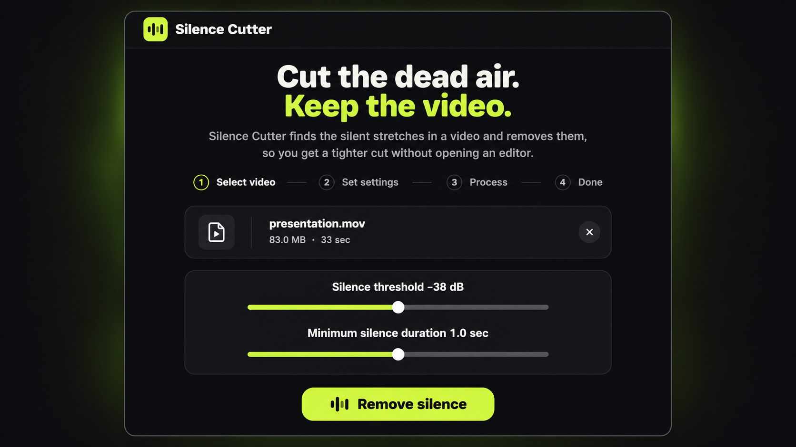

# 🎬 Silence Cutter

A lightweight local React/Vite and Python application that detects long silent sections in videos and creates an accurately trimmed MP4 copy.

---

## 📌 Project Overview

This tool is designed for content creators who want cleaner, more concise videos without manual editing.

It processes videos locally using FFmpeg and removes silent segments based on configurable thresholds.

## Application Preview

The current local React/Vite interface keeps the workflow focused: select a video, set the silence defaults, process it locally, and review the verified output.



### Workflow

1. Launch the application.
2. Select a video and configure the silence duration.
3. Wait for video processing to finish.
4. Review the verified result and open the generated output folder.

Successful outputs are named `<original-name>_cut_<date>_<time>.mp4`, for example `goo test_cut_2026-11-21_14-32-08.mp4`. The original input is never modified.

---

## 🚀 MVP Scope

### ✅ Included

- Rule-based silence detection using FFmpeg
- Local video processing (no cloud)
- React/Vite local interface with Flask bridge
- Accurate FFmpeg filter-graph export
- FFprobe validation of FFmpeg-readable video inputs
- Adjustable silence duration and dB threshold
- Cancellation, no-audio validation, and output-duration verification
- Public Render portfolio demo with 100 MB / five-minute / 1080p limits, temporary retention, and one active job

### ❌ Not Included

- AI transcription (Whisper, NLP)
- “um / ah” filler word removal
- Cloud processing or uploads
- Timeline-based editor
- Streaming/export presets

---

## 🧠 Core Idea

Remove long silent sections while keeping the rest of the video in the same order.

---

## ⚙️ System Architecture
User selects video
→ FFprobe validates video and audio
→ FFmpeg detects silence intervals
→ Build keep intervals
→ FFmpeg trims, normalizes timestamps, and concatenates intervals in one filter graph
→ Validate final MP4 duration


---

## 🔧 Technology Stack

- Python
- Flask
- React + Vite
- FFmpeg
- FFprobe

## 📦 Dependencies

Install the Python runtime dependency with:

```bash
python -m pip install -r requirements.txt
```

The application imports `customtkinter` directly. All other Python imports are from the standard library or this repository's `app/` package. Tkinter is also required for the desktop GUI; it is part of the Python standard library but may be packaged separately by some operating systems.

FFmpeg and FFprobe are required external command-line tools. Install them separately and ensure both `ffmpeg` and `ffprobe` are available on the system `PATH`:

```bash
ffmpeg -version
ffprobe -version
```

See [docs/dependencies.md](docs/dependencies.md) for the complete dependency notes. FFmpeg and FFprobe are intentionally excluded from `requirements.txt` because they are not Python packages.

## 🖥️ Desktop Development and Packaging Status

The React interface can run inside a local pywebview desktop window while reusing the existing Flask bridge and FFmpeg pipeline.

Start the development desktop window with two commands from the repository root:

```bash
npm run dev
python3 -m app.desktop
```

This is the development desktop workflow. It is not an installer. New React changes appear through Vite hot reload while developing.

An installable macOS, Windows, or Linux application is only needed when distributing Silence Cutter to users who should launch it by double-clicking. Until that phase is approved, commit the source code and documentation to GitHub, but do not commit generated installers or build artifacts.

The current repository has an automated checker for new changes. It runs the existing React build, Python syntax validation, and automated tests on pushes and pull requests. Desktop-window smoke testing remains a manual check when desktop-shell code changes.

---

## 🎥 Processing Strategy

### Silence Detection

Uses FFmpeg silence detection filters:

- Silence threshold (e.g. 1.5s+)
- Start/end timestamps extraction

### Output

- Retained intervals are rendered through one FFmpeg filter graph for accurate video/audio boundaries.
- Output is a separate H.264/AAC MP4.
- The original file remains unchanged.
- FFprobe verifies final duration against the expected retained duration.

---

## 🧱 Project Structure

```text
app/
├── main.py                   # Shared process_video() application service
├── silence_detector.py       # Detect silent sections with FFmpeg
├── silence_parser.py         # Parse FFmpeg silence logs
├── cut_builder.py            # Build retained intervals
├── filter_graph_exporter.py  # Accurate FFmpeg export
├── pipeline/                 # Output validation and cleanup
├── gui/                      # Desktop GUI adapter
└── bridge/                   # Flask adapter and job management
    ├── server.py             # Routes and JobManager
    ├── worker.py             # Background processing worker
    ├── media.py              # FFprobe metadata
    ├── validation.py         # Request and demo-limit validation
    └── job_state.py          # Public job response formatting
src/
├── main.jsx                  # React application composition
├── api.js                    # Centralized bridge API calls
└── features/video-processing/
    ├── media.js              # Browser metadata and error helpers
    ├── useJobPolling.js      # Job status polling
    └── jobOutcome.js         # Job-state to UI-phase mapping
assets/                       # Application assets and generated outputs
tests/                        # Automated processing tests
entry.py                      # Packaged application entry point
```

The desktop GUI and React/Flask bridge both use the shared Python `process_video()` service. The bridge and UI translate their own interfaces into that service; video-processing rules are not duplicated between them.

See [docs/architecture/mvp-refactor-plan.md](docs/architecture/mvp-refactor-plan.md) for the refactoring decisions and phase checkpoints.


---

## ⚙️ Processing Flow

1. User selects video file
2. FFmpeg detects silence segments
3. Extract timestamps
4. Convert into keep intervals
5. Render retained intervals in one FFmpeg filter graph
6. Validate and export final MP4

---

## 🎛️ UI (MVP Preview)
Silence Cutter
[ Select Video ]
Silence Threshold: 1.5s
[------●------]
[ Start Processing ]
Progress: ███████░░░


---

## 🧪 Build Plan

### 1. Dependencies
Install the Python and external dependencies described above.

### 2. Processing Pipeline
Parse silence timestamps and build retained intervals.

### 3. Video Processing
Cut and merge retained segments with FFmpeg.

### 4. GUI
Provide the desktop interface for selecting videos and starting processing.

### 5. Testing
Run the automated processing tests with `python -m pytest`.

---

## ⚡ Key Design Principle

No AI editing.

Only:
> FFmpeg-based silence detection + deterministic video reconstruction

---

## 🎯 Output Behavior

Input:
- Raw video with pauses

Output:
- Clean video with:
  - long silences removed
  - retained segments joined in order


---

## 🖥️ How to Use the App

In one terminal, start the local Python bridge:

```bash
python3 -m app.bridge.server
```

In a second terminal, start the React interface:

```bash
npm run dev
```

Open the Vite address shown in the terminal, normally `http://localhost:5173`.

Select a video, configure silence duration and threshold, then choose **Remove silence**. The original remains unchanged and successful output is written as a separate MP4.

---

## ⚠️ Notes

- Fully offline tool
- No uploads required
- Optimized for simplicity and speed
- Designed for local, simple video cleanup

## 🌐 Portfolio Deployment

The default development workflow is intentionally local-first: the React interface talks to a Flask bridge on the same computer, and videos do not leave that computer. A public portfolio demo is live at [silence-cutter-portfolio.onrender.com](https://silence-cutter-portfolio.onrender.com/). It accepts temporary uploads, produces a download, and deletes job files after up to 30 minutes. The Render free tier can sleep after inactivity, so the first request may take around a minute.

When you are ready to create a public portfolio demo, follow the beginner-focused [Render portfolio deployment guide](docs/deployment/render-portfolio-guide.md). It explains Docker, the required upload/download and temporary-file changes, safety limits, and the manual Render steps without assuming Docker experience.

---

## 📈 Future Improvements

- Whisper-based transcript editing
- Filler word removal (“um / ah”)
- Scene detection
- Auto captions
- Timeline preview editor


## Legacy CustomTkinter Packaging

The instructions below apply only to the original CustomTkinter/PyInstaller desktop application. They do not package the current React/Vite + Flask workflow, which is intentionally limited to local development and portfolio demonstration for this migration milestone.

`assets/icon.icns` is retained as the legacy macOS application icon. It is deprecated for the React/Vite web interface, which uses `public/favicon.svg` for its browser-tab icon.

`assets/deprecated/silence-cutter-preview-legacy.png` is retained as the deprecated CustomTkinter-era application preview. The README uses `assets/silence-cutter-hero-v2.png` for the current React/Vite interface.

# Building the Legacy Silence Cutter App

## macOS Build (.app)

Use the following command to generate a macOS application bundle:

```bash
pyinstaller --clean \
--windowed \
--name SilenceCutter \
--icon assets/icon.icns \
--add-data "assets:assets" \
entry.py
```

Explanation:

* `--clean` → removes old build cache
* `--windowed` → hides terminal window for GUI applications
* `--name SilenceCutter` → sets the application name
* `--icon assets/icon.icns` → sets the macOS app icon
* `--add-data "assets:assets"` → includes assets (icons, images, FFmpeg, etc.)
* `entry.py` → application entry point

Generated output:

```text
dist/
└── SilenceCutter.app
```

Run the application:

```bash
open dist/SilenceCutter.app
```

---

## Windows Build (.exe)

Use the following command to generate a Windows executable:

```bash
pyinstaller --clean ^
--windowed ^
--name SilenceCutter ^
--icon assets\icon.ico ^
--add-data "assets;assets" ^
entry.py
```

Explanation:

* Windows uses `.ico` files for icons
* Windows uses `;` instead of `:` in `--add-data`

Generated output:

```text
dist/
└── SilenceCutter.exe
```

---

## Debug Build (Recommended During Development)

If the application opens and closes silently, temporarily remove `--windowed` to display terminal logs:

macOS:

```bash
pyinstaller --clean \
--name SilenceCutter \
--icon assets/icon.icns \
--add-data "assets:assets" \
entry.py
```

Windows:

```bash
pyinstaller --clean ^
--name SilenceCutter ^
--icon assets\icon.ico ^
--add-data "assets;assets" ^
entry.py
```

run:
open dist/SilenceCutter.app
