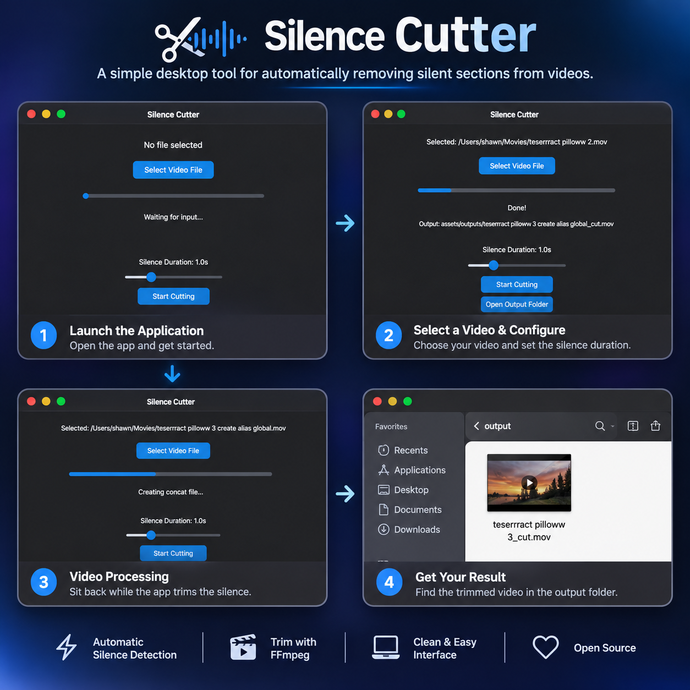

# 🎬 Silence Cutter Desktop App

A lightweight desktop application that detects long silent sections in videos and creates a trimmed copy.

---

## 📌 Project Overview

This tool is designed for content creators who want cleaner, more concise videos without manual editing.

It processes videos locally using FFmpeg and removes silent segments based on configurable thresholds.

## Application Preview

Silence Cutter automatically detects silent sections and creates a trimmed video using FFmpeg.



### Workflow

1. Launch the application.
2. Select a video and configure the silence duration.
3. Wait for video processing to finish.
4. Open the generated output folder.

---

## 🚀 MVP Scope

### ✅ Included

- Rule-based silence detection using FFmpeg
- Local video processing (no cloud)
- Desktop GUI (CustomTkinter)
- Video segment trimming and merging with FFmpeg
- Common video input/output formats
- Adjustable silence threshold

### ❌ Not Included

- AI transcription (Whisper, NLP)
- “um / ah” filler word removal
- Cloud processing or uploads
- Timeline-based editor
- Streaming/export presets

---

## 🧠 Core Idea

Remove long silent sections while keeping the rest of the video in the same order.

---

## ⚙️ System Architecture
User selects video
→ FFmpeg detects silence intervals
→ Build keep/cut timestamps
→ FFmpeg trims and merges segments
→ Export final MP4


---

## 🔧 Technology Stack

- Python
- FFmpeg
- FFprobe
- CustomTkinter

## 📦 Dependencies

Install the Python runtime dependency with:

```bash
python -m pip install -r requirements.txt
```

The application imports `customtkinter` directly. All other Python imports are from the standard library or this repository's `app/` package. Tkinter is also required for the desktop GUI; it is part of the Python standard library but may be packaged separately by some operating systems.

FFmpeg and FFprobe are required external command-line tools. Install them separately and ensure both `ffmpeg` and `ffprobe` are available on the system `PATH`:

```bash
ffmpeg -version
ffprobe -version
```

See [docs/dependencies.md](docs/dependencies.md) for the complete dependency notes. FFmpeg and FFprobe are intentionally excluded from `requirements.txt` because they are not Python packages.

---

## 🎥 Processing Strategy

### Silence Detection

Uses FFmpeg silence detection filters:

- Silence threshold (e.g. 1.5s+)
- Start/end timestamps extraction

### Output

- Selected video segments are copied and merged with FFmpeg.
- Audio is encoded as AAC while segments are cut.
- The original resolution is not changed by the application.

---

## 🧱 Project Structure

```text
app/
├── gui/gui.py                # Desktop GUI
├── main.py                   # Processing pipeline
├── silence_parser.py         # Parse FFmpeg silence logs
├── cut_builder.py            # Build retained intervals
└── pipeline/                 # Output validation and cleanup
assets/                       # Application assets and generated outputs
tests/                        # Automated processing tests
entry.py                      # Packaged application entry point
```


---

## ⚙️ Processing Flow

1. User selects video file
2. FFmpeg detects silence segments
3. Extract timestamps
4. Convert into keep/cut intervals
5. Rebuild video using FFmpeg concat
6. Export final MP4

---

## 🎛️ UI (MVP Preview)
Silence Cutter
[ Select Video ]
Silence Threshold: 1.5s
[------●------]
[ Start Processing ]
Progress: ███████░░░


---

## 🧪 Build Plan

### 1. Dependencies
Install the Python and external dependencies described above.

### 2. Processing Pipeline
Parse silence timestamps and build retained intervals.

### 3. Video Processing
Cut and merge retained segments with FFmpeg.

### 4. GUI
Provide the desktop interface for selecting videos and starting processing.

### 5. Testing
Run the automated processing tests with `python -m pytest`.

---

## ⚡ Key Design Principle

No AI editing.

Only:
> FFmpeg-based silence detection + deterministic video reconstruction

---

## 🎯 Output Behavior

Input:
- Raw video with pauses

Output:
- Clean video with:
  - long silences removed
  - retained segments joined in order


---

## 🖥️ How to Use the App

1. Run the GUI (Recommended)
This is the main user entry point:
python -m app.gui.gui

This launches the desktop interface.

From the GUI:
Select video
Set silence duration
Click Start Cutting
Backend pipeline runs automatically

---

## ⚠️ Notes

- Fully offline tool
- No uploads required
- Optimized for simplicity and speed
- Designed for local, simple video cleanup

---

## 📈 Future Improvements

- Whisper-based transcript editing
- Filler word removal (“um / ah”)
- Scene detection
- Auto captions
- Timeline preview editor


## creaete build apps Mode: 
- create new build apps: 

# Building Silence Cutter

## macOS Build (.app)

Use the following command to generate a macOS application bundle:

```bash
pyinstaller --clean \
--windowed \
--name SilenceCutter \
--icon assets/icon.icns \
--add-data "assets:assets" \
entry.py
```

Explanation:

* `--clean` → removes old build cache
* `--windowed` → hides terminal window for GUI applications
* `--name SilenceCutter` → sets the application name
* `--icon assets/icon.icns` → sets the macOS app icon
* `--add-data "assets:assets"` → includes assets (icons, images, FFmpeg, etc.)
* `entry.py` → application entry point

Generated output:

```text
dist/
└── SilenceCutter.app
```

Run the application:

```bash
open dist/SilenceCutter.app
```

---

## Windows Build (.exe)

Use the following command to generate a Windows executable:

```bash
pyinstaller --clean ^
--windowed ^
--name SilenceCutter ^
--icon assets\icon.ico ^
--add-data "assets;assets" ^
entry.py
```

Explanation:

* Windows uses `.ico` files for icons
* Windows uses `;` instead of `:` in `--add-data`

Generated output:

```text
dist/
└── SilenceCutter.exe
```

---

## Debug Build (Recommended During Development)

If the application opens and closes silently, temporarily remove `--windowed` to display terminal logs:

macOS:

```bash
pyinstaller --clean \
--name SilenceCutter \
--icon assets/icon.icns \
--add-data "assets:assets" \
entry.py
```

Windows:

```bash
pyinstaller --clean ^
--name SilenceCutter ^
--icon assets\icon.ico ^
--add-data "assets;assets" ^
entry.py
```

run:
open dist/SilenceCutter.app
