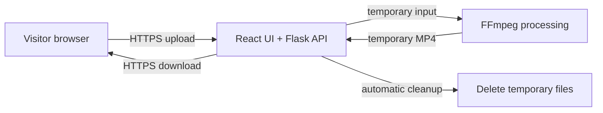

# Deploying Silence Cutter as a Portfolio Demo

Status: Planning and manual-deployment guide. This is **not** an instruction to deploy the current local-only build unchanged.

## What this guide is for

This guide explains a beginner-friendly future deployment of Silence Cutter on Render. The goal is a small public portfolio demo where a visitor can upload a video, remove silence, and download an MP4 result.

It is deliberately written for someone new to Docker. You do not need to learn Docker broadly before using this guide; you only need to understand the small set of ideas below.

## Important current limitation

The current React/Vite + Flask bridge is local-first:

- The browser selects a local file.
- The React client already sends that file as multipart data to Flask at `127.0.0.1`; the bridge also retains a legacy local-path API for local development.
- Flask and FFmpeg read and write files on the same computer.

The existing multipart route is a useful starting point, but it cannot be deployed unchanged: it has no public upload limits, does not guarantee cleanup of successful-job input/output files, and returns a local-folder action rather than a browser download. A Render server also cannot use the legacy visitor-local-path API. Before deployment, the bridge needs public-safe upload, download, and cleanup behavior.

## Recommended architecture

Use one Render Docker web service for the first public demo:



One service is simpler than hosting the frontend and API separately. Docker makes the service reproducible because it bundles the operating-system packages the app needs, including FFmpeg.

## Docker in plain language

| Term | Meaning in this project |
|---|---|
| Dockerfile | A small recipe that says: start from a Python/Node environment, install FFmpeg and app dependencies, then start the app. |
| Image | The packaged result of that recipe. Think of it as a reusable application snapshot. |
| Container | A running copy of the image. Render runs this for you. |
| `.dockerignore` | A safety/performance list of files not to send into the image build, such as `node_modules`, test videos, outputs, and `.git`. |

You will not need to run or manage servers manually. Render builds the image from the repository, starts the container, and provides the public HTTPS address.

## Scope for the deployment change

### Included

- Browser file upload to Flask instead of sending a local file path.
- Per-job temporary directories on the server.
- Download endpoint for the completed MP4.
- A strict upload-size limit and one active job per visitor/session.
- Automatic cleanup after download or a short expiry.
- Dockerfile, `.dockerignore`, and Render deployment configuration.
- A public privacy notice explaining temporary processing and deletion.

### Not included in the first deployed demo

- Accounts or sign-in.
- Permanent storage or processing history.
- Background queues or multiple-worker scaling.
- Large, unlimited, or production-grade video workloads.
- Paid billing integration.

## Deployment safety decisions to approve before implementation

These are proposed starting values, not implemented behavior:

| Decision | Proposed initial value | Why |
|---|---:|---|
| Maximum upload size | 100 MB | Keeps a free portfolio demo responsive and limits abuse. |
| Maximum input duration | 5 minutes | Bounds FFmpeg workload. |
| Output retention | 30 minutes | Lets the visitor download the result while limiting data retention. |
| Concurrent job limit | 1 per service | Prevents a small free instance from being overloaded. |
| Supported output | H.264/AAC MP4 | Matches current output behavior and broad browser compatibility. |

Do not present a public uploader until these values, error handling, and cleanup are implemented and tested.

## Manual implementation path

### 1. Create a deployment specification

Before coding, approve the limits above and define the upload/download API contract. Update the React migration specification and implementation record with the new phase.

### 2. Make the bridge web-safe

- Accept multipart uploads rather than client file paths.
- Generate an unpredictable job ID and create one temporary directory per job.
- Store the uploaded file only inside that directory.
- Reject unsupported, oversized, or audio-less inputs before processing.
- Keep the existing FFprobe validation, cancellation, duration verification, and FFmpeg argument-array safety.
- Delete the input, temporary files, and output after expiry—even when processing fails.

### 3. Adapt the React client

- Send the selected file with `FormData`.
- Show the configured size limit before upload.
- Continue to show processing, cancellation, failure, no-silence, and timing-warning states.
- Replace the local “open output folder” action with a download button, because a public server cannot open a visitor's folder.

### 4. Add Docker files

The Dockerfile should install Node, Python dependencies, and FFmpeg; build the Vite application; and start Flask with a production web server. The `.dockerignore` should exclude local outputs, input media, `node_modules`, `.git`, and test fixtures.

### 5. Test locally with Docker

Build the image and run it locally before using Render. Confirm a normal input, no-audio input, no-silence input, cancellation, download, and automatic cleanup.

From the repository root, run:

```bash
docker build --tag silence-cutter-portfolio:local .
docker run --rm --publish 10000:10000 --env PORT=10000 silence-cutter-portfolio:local
```

Then open `http://localhost:10000` and check `http://localhost:10000/api/health`. The expected health response includes `"public_mode": true`. Stop the container with `Ctrl+C` when you finish. Docker is only needed for this local verification and for reproducing the same environment Render will use.

### 6. Create the Render service

1. Push the approved deployment branch to GitHub.
2. In Render, choose **New → Web Service** and connect this repository.
3. Select the Docker runtime.
4. Use the deployment branch first; switch to `main` only after approval.
5. Configure the service to bind to Render's `PORT` environment variable on `0.0.0.0`.
6. Deploy and use the generated `onrender.com` URL for the portfolio link.

Render's free tier is suitable for a small demo but sleeps after inactivity; visitors may wait around a minute for it to wake. Do not describe it as an always-on production service.

## Manual verification checklist

- [ ] The live site uses HTTPS.
- [ ] The frontend does not contain `127.0.0.1` or a local filesystem path.
- [ ] A valid small video uploads, processes, and downloads as a separate MP4.
- [ ] The original local input remains unchanged.
- [ ] Oversized and no-audio inputs show clear errors.
- [ ] Cancellation removes the job's temporary files.
- [ ] Expired jobs are deleted automatically.
- [ ] The service rejects two simultaneous processing jobs safely.
- [ ] The privacy notice accurately states the retention period.
- [ ] The deployed app is tested from a device outside the development computer.

## How to present it in your portfolio

Use a simple, honest description:

> Silence Cutter is a React/Vite and Flask portfolio project that uses FFmpeg to detect and remove long silent segments. The demo processes uploads temporarily, returns a separate MP4, and automatically cleans up temporary files.

Also link to the README, this deployment guide, and a short screen recording. That demonstrates both the user experience and the engineering decisions behind it.

## References

- [Render Web Services documentation](https://render.com/docs/web-services)
- [Render Docker documentation](https://render.com/docs/docker)
- [Render free Docker hosting details](https://render.com/hosting/docker)
