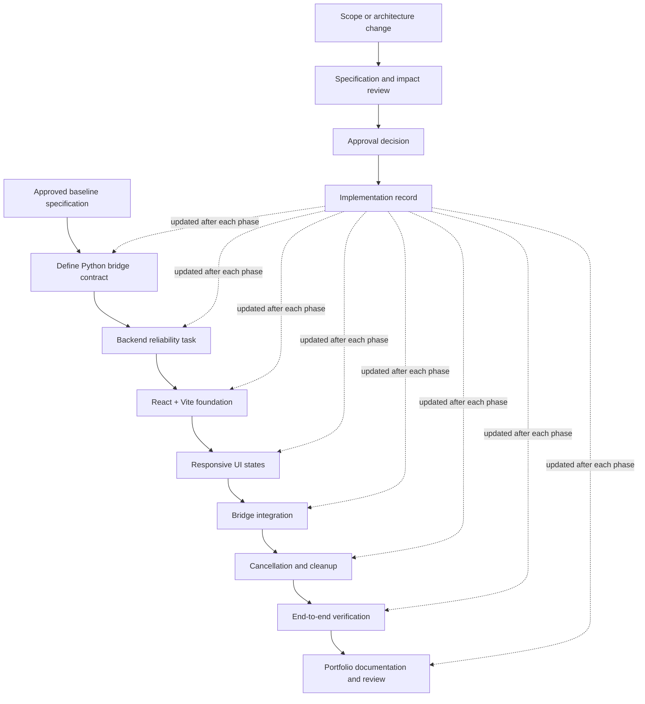

# React Migration Roadmap

Current milestone: React/Vite interface, Flask bridge, accurate filter-graph exporter, synthetic timing tests, audio validation, output-duration validation, and pre-export all-content removal protection are implemented and verified by automated tests/build.

Next milestone: deploy the verified safety fix, then run the manual real-video workflow when a laptop is available. The next approved UX scope is stage-based processing feedback and a simplified workflow stepper; see `all-content-removal-specification.md`.
